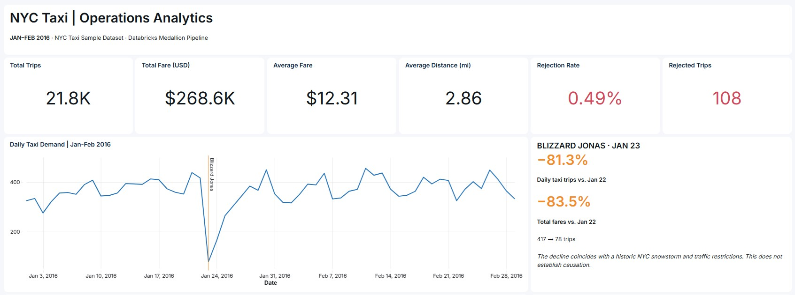
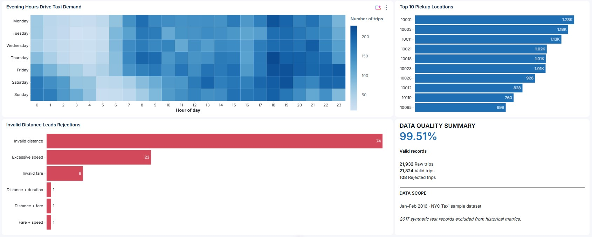
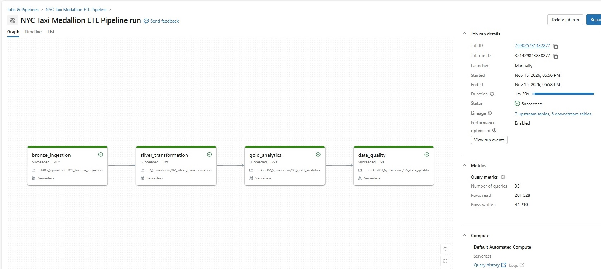

# NYC Taxi Analytics | Databricks Medallion Pipeline

**End-to-End Data Engineering & Analytics Portfolio Project**

An end-to-end data pipeline built with **Databricks, PySpark, SQL, and Delta Lake**, following the **Medallion Architecture (Bronze → Silver → Gold)**.

The project demonstrates incremental ingestion, automated data validation, quarantine handling, analytical data modeling, workflow orchestration, and interactive business intelligence dashboards.

## Project Highlights

| Metric | Result |
|---|---|
| Historical taxi trips analyzed | 21,932 |
| Valid trips | 21,824 |
| Data rejection rate | **0.49%** |
| ETL workflow | **4/4 tasks succeeded** |
| Verified workflow execution | **1 min 30 sec** |
| Blizzard Jonas: trip volume change | **-81.3% day over day** |

### Analytics Dashboard





---

## 1. Project Overview

The objective of this project is to transform raw NYC taxi trip records into validated, analytics-ready datasets and actionable business insights.

The pipeline processes taxi trip records, validates data quality, separates invalid records, creates analytical aggregates, and supports an interactive Databricks AI/BI Dashboard.

### Key Capabilities

- Incremental ingestion using Delta Lake `MERGE`
- SHA-256-based trip identification and deduplication
- Bronze, Silver, and Gold data architecture
- Automated validation of distance, fare, duration, ZIP codes, and speed
- Quarantine of invalid records with detailed rejection reasons
- Analytical aggregation by date, weekday, hour, and pickup ZIP code
- Automated reconciliation across data layers
- Four-task Databricks Workflow orchestration
- Interactive dashboard with operational KPIs and business insights

## 2. Technology Stack

| Category | Technologies |
|---|---|
| Platform | Databricks Free Edition |
| Data Processing | Apache Spark, PySpark |
| Storage | Delta Lake |
| Query Language | SQL |
| Programming | Python |
| Data Architecture | Medallion Architecture |
| Orchestration | Databricks Workflows |
| Data Quality | PySpark validations and assertions |
| Visualization | Databricks AI/BI Dashboards |
| Version Control | Git, GitHub |

The project uses Databricks serverless compute.

## 3. Medallion Architecture

```text
                 NYC Taxi Source Dataset
                   samples.nyctaxi.trips
                            |
                            v
                    +---------------+
                    | BRONZE LAYER  |
                    |---------------|
                    | Raw data      |
                    | SHA-256 keys  |
                    | Metadata      |
                    | Delta MERGE   |
                    +---------------+
                            |
                            v
                    +---------------+
                    | SILVER LAYER  |
                    |---------------|
                    | Validation    |
                    | Cleaning      |
                    | Derived fields|
                    | Delta MERGE   |
                    +---------------+
                       |         |
                    Valid      Invalid
                       |         |
                       |         v
                       |   +--------------+
                       |   | QUARANTINE   |
                       |   | Reasons      |
                       |   +--------------+
                       v
                    +---------------+
                    |  GOLD LAYER   |
                    |---------------|
                    | Daily KPIs    |
                    | Hourly demand |
                    | Pickup ZIPs   |
                    +---------------+
                            |
                            v
                    +---------------+
                    | DATABRICKS    |
                    | AI/BI         |
                    | DASHBOARD     |
                    +---------------+

                 DATA QUALITY CHECKS
              Reconciliation across layers
```

### Bronze Layer — Raw Data Ingestion

The Bronze layer ingests taxi trip records from the Databricks NYC Taxi sample dataset.

Implementation:

- Reads data using Spark DataFrames
- Adds source system and ingestion timestamp metadata
- Generates a SHA-256 `trip_key` from trip attributes
- Creates the initial Delta table when absent
- Uses insert-only Delta `MERGE` for incremental loads
- Validates uniqueness of persisted trip keys

**Table:** `workspace.nyc_taxi.bronze_trips`

**Notebook:** [01_bronze_ingestion.py](notebooks/01_bronze_ingestion.py)

### Silver Layer — Validation and Quarantine

The Silver layer applies business rules and separates valid trips from invalid records.

| Validation Rule | Condition |
|---|---|
| INVALID_DISTANCE | Missing or non-positive distance |
| INVALID_FARE | Missing or non-positive fare |
| INVALID_DURATION | Missing or non-positive duration |
| MISSING_ZIP | Missing pickup or dropoff ZIP code |
| EXCESSIVE_SPEED | Average trip speed above 80 mph |

Calculated fields:

- `duration_minutes`
- `avg_speed_mph`
- `rejection_reason`

Valid records are inserted into the Silver table, while invalid records are preserved in a separate Quarantine table.

Both tables are automatically initialized when absent, using the schemas derived from the validated DataFrames.

Subsequent loads use insert-only Delta `MERGE` operations.

Additional checks verify uniqueness, prevent overlap between Silver and Quarantine, and reconcile record counts.

**Tables:**

- `workspace.nyc_taxi.silver_trips`
- `workspace.nyc_taxi.silver_quarantine`

**Notebook:** [02_silver_transformation.py](notebooks/02_silver_transformation.py)

### Gold Layer — Analytical Data Models

The Gold layer converts validated Silver data into three analytical tables.

| Table | Purpose |
|---|---|
| `gold_daily_kpi` | Daily trips, fares, and average distance |
| `gold_hourly_demand` | Trip demand by weekday and hour |
| `gold_top_zips` | Pickup ZIP activity and performance |

The Gold tables are fully recalculated using Delta overwrite operations.

Reconciliation checks verify that aggregated trip totals match the Silver dataset.

**Notebook:** [03_gold_analytics.py](notebooks/03_gold_analytics.py)

## 4. ETL Workflow Orchestration

The pipeline is orchestrated with four sequential Databricks Workflow tasks:

```text
bronze_ingestion
       |
       v
silver_transformation
       |
       v
gold_analytics
       |
       v
data_quality
```

Each task runs only after its predecessor completes successfully.

The final Data Quality task raises an exception if any validation or reconciliation check fails.

### Successful Workflow Execution



| Metric | Result |
|---|---|
| Workflow tasks | 4 |
| Successful tasks | 4 / 4 |
| Execution time | 1 min 30 sec |
| Compute | Databricks Serverless |
| Final status | Succeeded |

The screenshot documents an actual successful pipeline run.

In the Databricks workspace, the final task references a notebook named `05_data_quality`. In this repository, the corresponding source file is named `04_data_quality.py` to reflect its position as the fourth core pipeline stage.

## 5. Incremental Processing with Delta Lake

Bronze and Silver implement insert-only Delta Lake `MERGE` operations.

### Processing Strategy

1. Generate a SHA-256 key from trip attributes.
2. Compare incoming records with existing Delta records.
3. Insert previously unseen trip keys.
4. Avoid duplicate inserts during repeated processing.
5. Validate counts and key uniqueness after processing.

This approach supports idempotent reprocessing of unchanged source data.

### End-to-End Incremental Test

An additional synthetic batch of 100 taxi trips was used to validate incremental processing.

| Metric | Result |
|---|---:|
| New source records | 100 |
| Inserted into Bronze | 100 |
| Inserted into Silver | 99 |
| Quarantined | 1 |
| Rejection reason | EXCESSIVE_SPEED |

Delta Lake table history was inspected to verify the test results.

The tested operations recorded:

- 100 Bronze insertions
- 99 Silver insertions
- 1 Quarantine insertion
- No updates or deletions during the tested MERGE operations

The test confirmed that valid records reached the analytical layer, while invalid records were routed to Quarantine.

## 6. Data Quality Framework

Data quality checks are implemented at both record and pipeline levels.

### Record-Level Validation

Silver validates trip distance, fares, duration, ZIP completeness, and realistic average speed.

Invalid records are preserved with their associated rejection reasons.

### Pipeline-Level Validation

The final notebook performs six automated checks:

1. Bronze count equals Silver plus Quarantine.
2. Daily Gold trip totals equal Silver trip count.
3. Hourly Gold trip totals equal Silver trip count.
4. Pickup ZIP Gold trip totals equal Silver trip count.
5. Silver is not empty.
6. Quarantined records contain rejection reasons.

If any check fails, the notebook raises an exception and the task fails.

**Notebook:** [04_data_quality.py](notebooks/04_data_quality.py)

### Historical Data Quality Results

**Analysis period:** January 1 – February 29, 2016

| Metric | Value |
|---|---:|
| Raw trips | 21,932 |
| Valid trips | 21,824 |
| Rejected trips | 108 |
| Rejection rate | 0.49% |

Rejection rate:

`Rejected trips / Raw trips × 100`

The most common rejection categories included invalid distances, excessive speeds, and invalid fares.

### Incremental Test Totals

After the synthetic incremental batch:

| Layer | Records |
|---|---:|
| Bronze | 22,032 |
| Silver | 21,923 |
| Quarantine | 109 |

**Reconciliation:** `22,032 = 21,923 + 109`

All three Gold aggregate tables also reconciled to **21,923 valid trips**.

## 7. Business Intelligence Dashboard

An interactive Databricks AI/BI Dashboard was developed to analyze historical taxi activity and data quality.

### Historical Dashboard KPIs

| KPI | Value |
|---|---:|
| Total Trips | 21,824 |
| Total Fare Revenue | $268,604.03 |
| Average Fare | $12.31 |
| Average Trip Distance | 2.86 mi |
| Rejection Rate | 0.49% |
| Rejected Trips | 108 |

### Visualizations

**Daily Trips Trend**

Daily trip volume for January–February 2016.

**Daily Fare Revenue**

Daily total taxi fares in USD.

**Taxi Demand Heatmap**

Trip distribution by weekday and hour of day.

**Top 10 Pickup ZIP Codes**

Highest-volume pickup ZIP codes.

**Data Quality — Rejection Reasons**

Breakdown of quarantined records by validation failure category.

### Data Scope

The dashboard focuses exclusively on historical data from January–February 2016.

Synthetic records from 2017, used to test incremental processing, are excluded from historical dashboard metrics.

This separation prevents testing data from distorting business analysis.

## 8. Business Insight — Blizzard Jonas

A significant decline in taxi activity occurred on **January 23, 2016**, coinciding with the historic Blizzard Jonas snowstorm and traffic restrictions in New York City.

### Day-over-Day Comparison

| Metric | January 22 | January 23 | Change |
|---|---:|---:|---:|
| Taxi Trips | 417 | 78 | -81.3% |
| Total Fares | $4,672.50 | $772.50 | -83.5% |

### Interpretation

Taxi demand and total fares declined sharply during the storm period.

The timing is consistent with disruptions associated with severe weather and transportation restrictions.

This example demonstrates how operational data can help identify unusual demand patterns and support further business investigation.

The observed temporal relationship does not, by itself, establish causation.

## 9. Repository Structure

```text
nyc-taxi-medallion-pipeline/
|
|-- notebooks/
|   |-- 01_bronze_ingestion.py
|   |-- 02_silver_transformation.py
|   |-- 03_gold_analytics.py
|   `-- 04_data_quality.py
|
|-- docs/
|   `-- images/
|       |-- dashboard_overview.jpg
|       |-- dashboard_details.jpg
|       |-- etl_workflow.jpg
|       `-- .gitkeep
|
`-- README.md
```

## 10. Running the Project

### Requirements

- Databricks workspace with Spark and Delta Lake
- Access to the `samples.nyctaxi.trips` sample dataset
- Permissions to create schemas and tables
- Python / PySpark notebook execution environment

### Execution Order

Run the notebooks in this order:

1. [01_bronze_ingestion.py](notebooks/01_bronze_ingestion.py)
2. [02_silver_transformation.py](notebooks/02_silver_transformation.py)
3. [03_gold_analytics.py](notebooks/03_gold_analytics.py)
4. [04_data_quality.py](notebooks/04_data_quality.py)

The notebooks use the following Unity Catalog namespace:

`workspace.nyc_taxi`

The Bronze notebook creates the target schema when necessary.

The Silver notebook creates its target Delta tables when absent.

Gold tables are built from validated Silver records.

The final Data Quality notebook verifies reconciliation across all layers.

**Note:** Existing-table execution was verified in Databricks. A complete fresh-workspace deployment has not yet been independently tested.

The Databricks Workflow configuration and interactive Dashboard are maintained within the Databricks workspace.

The GitHub repository contains the exported pipeline logic and screenshots of the implementation.

## 11. Engineering Decisions and Limitations

### Insert-Only Delta MERGE

Bronze and Silver insert new records and avoid duplicate inserts.

The current implementation does not propagate source updates or deletions.

### Full Gold Refresh

Gold uses overwrite operations rather than incremental MERGE.

For the current dataset size, this provides a straightforward and consistent aggregation strategy.

### Quarantine Strategy

Invalid records are retained separately with rejection reasons rather than being silently discarded.

This improves transparency and supports data quality investigation.

### Development Environment

The project uses a Databricks sample dataset and synthetic incremental records.

It demonstrates data engineering and analytics techniques in a portfolio environment rather than representing a production transportation platform.

### Potential Improvements

- Automated integration tests for fresh-workspace deployment
- Incremental Gold processing for larger datasets
- Schema evolution management
- Automated deployment of Workflow and Dashboard definitions
- CI/CD and unit testing
- Monitoring and operational alerting

## 12. Project Outcomes

This project demonstrates hands-on experience with:

- Designing Medallion Architecture data pipelines
- Implementing PySpark transformations
- Using Delta Lake MERGE and table history
- Building data validation and quarantine workflows
- Creating analytical data models
- Orchestrating dependent processing tasks
- Reconciling data across multiple layers
- Developing BI dashboards and operational KPIs
- Communicating business insights and data limitations

---

**Project Type:** Data Engineering / Data Analytics Portfolio

**Platform:** Databricks Free Edition

**Data Source:** Databricks NYC Taxi sample dataset

**Author:** Ihor Prudkyi

**GitHub:** [prutkih86-oss](https://github.com/prutkih86-oss)

